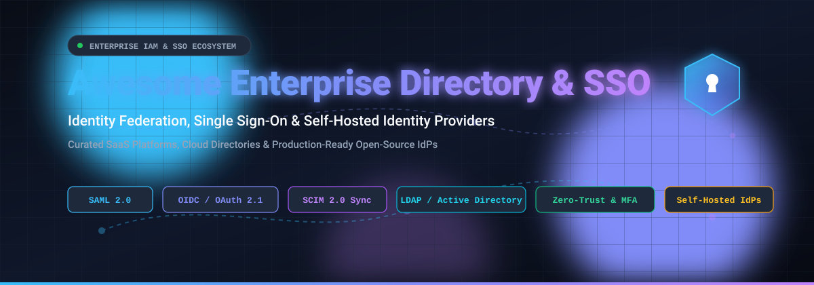

# 🔐 Awesome-Enterprise-Directory-SSO

  

  
  
  
  
  

## 🛡️ Top Enterprise Directory & SSO Ecosystem

**Curated List of SaaS Platforms & Open-Source GitHub Projects**  
*Focused on Identity Federation, Single Sign-On, Directory Services, and Self-Hosted Identity Providers*  
**Last updated: March 2026**

This repository tracks notable **SaaS platforms** and **open-source projects** for **Enterprise Directory & Single Sign-On (SSO)**. These tools enable organizations, IT architects, and developers to centralize authentication, authorization, user provisioning (SCIM), and directory synchronization (LDAP/AD/Kerberos)—allowing employees and customers to access multiple services with a single set of credentials. Solutions span from hyperscale commercial cloud IdPs to self-hosted, sovereign open-source platforms eliminating compounding per-seat SaaS licensing.

---

## 📑 Table of Contents
- [🌐 Sector Overview & Market Dynamics](#-sector-overview--market-dynamics)
- [☁️ SaaS / Hosted Enterprise Platforms](#️-saas--hosted-enterprise-platforms)
- [🔓 Open-Source GitHub Projects](#-open-source-github-projects)
- [🤝 How to Contribute](#-how-to-contribute)
- [💖 Support](#-support)
- [📈 Star History](#-star-history)
- [⚠️ Disclaimer](#️-disclaimer)

---

## 🌐 Sector Overview & Market Dynamics

The global Identity and Access Management (IAM), Directory, and SSO market is estimated at approximately **$21B to $25B**, expanding at a 15–25% CAGR driven by zero-trust security postures, hybrid workforce distribution, and multi-cloud infrastructure adoption. The sector exhibits a **moderately concentrated top-tier** where tech titans and dedicated cybersecurity vendors (Microsoft, Okta, CyberArk, Ping Identity) capture ~40% of enterprise expenditure through bundled suites and ecosystem lock-in. Meanwhile, the remaining ~60% represents a **heavily fragmented long-tail** of specialized access tools, non-human identity (NHI) frameworks, and extensible open-source IdPs addressing strict data sovereignty, homelab autonomy, and cost-effective deployment requirements.

---

## ☁️ SaaS / Hosted Enterprise Platforms

| 🏢 Product | 📊 Company Scale (Valuation / Market Cap / Revenue) | 📝 Description | 💵 Starting Pricing | 🎁 Free Tier / Trial Limits |
|---|---|---|---|---|
| **[Microsoft Entra ID](https://www.microsoft.com/en-us/security/business/identity-access/microsoft-entra-id)** | ~$3.89 Trillion (Market Cap) | Cloud IAM with tenant-level administration, conditional access, and hybrid identity synchronization. Microsoft exerts pricing pressure on the market through Entra ID bundling. | **$6/user/month** (Entra ID P1; P2 at $9/user/month) | **Free edition forever**: Core directory, self-service password reset for cloud users, and security defaults (included with Azure/M365 accounts) |
| **[Google Workspace Identity](https://workspace.google.com/)** | ~$3.5 Trillion (Alphabet Market Cap) | Cloud Identity and access management embedded in Google Workspace and GCP, providing SAML/OIDC SSO and directory services. | **$6/user/month** (Cloud Identity Premium; Business Starter: $7/user/month) | **Free edition forever**: 50 free user licenses for Cloud Identity Free (or 14-day free trial on Workspace tiers) |
| **[Okta](https://www.okta.com/)** | ~$32 Billion (Market Cap) | Enterprise workforce and customer identity with multi-tenant org management, universal directory, and workflow automation. | **$6/user/month** (Workforce Starter, annual contract; Enterprise: $17/user/month) | **30-day free trial**: Capped at 10 active users and 5 active workflows (developer free plan available with deactivation after 90 days inactivity) |
| **[CyberArk Identity](https://www.cyberark.com/)** | ~$21.1 Billion (Acquisition Valuation) | Identity security platform providing workforce SSO, Adaptive MFA, directory integration, and privileged access security. | **$2.27/user/month** (Standalone SSO; bundled Workforce Identity starts around $4–$7.20/user/month) | **30-day free trial**: Full access to SSO and Adaptive MFA for evaluation; training virtual lab environments limited to 14 days |
| **[Ping Identity](https://www.pingidentity.com/)** | ~$2.8 Billion (Buyout Valuation; ~$1B Combined ARR) | Enterprise IAM with identity governance, lifecycle management, and PingOne DaVinci identity orchestration for no-code authentication journeys. | **$3/user/month** (PingOne Workforce; minimum 5,000 users / $15,000/year commitment; Customer IAM from $35,000/year) | **30-day free trial**: Full access to PingOne Workforce evaluation environment |
| **[JumpCloud](https://jumpcloud.com/)** | ~$2.6 Billion (Valuation; ~$100M–$200M ARR) | Cloud directory platform combining identity, device management (MDM), and SSO to replace traditional Active Directory. | **$13/user/month** (SSO Package; Core Directory starts at $11/user/month) | **Free edition forever**: Fully functional up to 10 users and 10 devices |
| **[OneLogin](https://www.onelogin.com/)** | ~$500 Million (Acquisition Valuation; ~$70M+ ARR) | Mid-market workforce access management offering cloud directory, single sign-on, and policy management under One Identity. | **$4/user/month** (Advanced plan; Professional plan: $8/user/month) | **30-day free trial**: Limited to ~10–12 test user seats for administrative POC evaluation |

---

## 🔓 Open-Source GitHub Projects

Curated open-source identity providers, federation gateways, authentication servers, and directory bridges, sorted in descending order of GitHub community stars.

| 📦 Project | ⭐ Stars Badge | 💻 Stack & Protocols | 📖 Description & Capabilities |
|---|---|---|---|
| **[Keycloak](https://github.com/keycloak/keycloak)** |  | Java (Quarkus), OAuth 2.0, OIDC, SAML 2.0, LDAP, Kerberos | **The most widely deployed open-source identity provider with proven enterprise scale.** Apache-2.0. Multi-tenant realms manage users, roles, clients, and credentials independently. Features a robust SPI plugin architecture, SCIM 2.0 server provisioning, and built-in user federation. **Best for enterprises requiring battle-tested identity infrastructure with deep customization.** |
| **[Authelia](https://github.com/authelia/authelia)** |  | Go, OIDC, Forward Auth, LDAP, TOTP, WebAuthn | **Lightweight authentication and authorization server providing 2FA and SSO.** Apache-2.0. Acts as a companion gatekeeper for reverse proxies (Nginx, Traefik, Caddy, HAProxy, Envoy). **Best for homelabs, self-hosters, and teams needing reverse-proxy-based SSO without operating a full heavyweight IdP.** |
| **[Authentik](https://github.com/goauthentik/authentik)** |  | Python & Go, SAML, OIDC, SCIM, LDAP Outpost, Proxy | **The most flexible open-source sign-in flow engine.** MIT core. Highly customizable stages and policies edited visually without writing code. Outposts provide embedded LDAP/proxy gateways, alongside SCIM push provisioning. **Best for teams needing advanced flow orchestration, reverse proxy integration, and downstream SCIM provisioning.** |
| **[Ory Hydra](https://github.com/ory/hydra)** |  | Go, OpenID Connect Core 1.0, OAuth 2.0 / 2.1 | **Hardened, headless OAuth 2.0 and OpenID Connect Certified engine.** Apache-2.0. Connects to any existing user database or login UI, operating purely as a high-performance, stateless federation service. **Best for building custom-branded IdPs and federated authorization layers at massive scale.** |
| **[ZITADEL](https://github.com/zitadel/zitadel)** |  | Go & TypeScript, OIDC, OAuth 2.1, SAML, Passkeys | **Event-sourced identity management with turnkey multi-tenancy.** Apache-2.0. Every state mutation is an immutable event, providing built-in auditability, point-in-time state reconstruction, and hierarchical organization tenancy. **Best for SaaS platforms requiring B2B customer self-service, tenant isolation, and strict compliance logging.** |
| **[SuperTokens](https://github.com/supertokens/supertokens-core)** |  | Java & Node/Go/Python SDKs, OAuth2, SAML Enterprise SSO | **Developer-first modular authentication and authorization framework.** Core Apache-2.0. Provides turnkey session management, passwordless, social auth, and third-party enterprise SAML/ADFS federation. **Best for SaaS application developers seeking full code-level control over auth workflows.** |
| **[Casdoor](https://github.com/casdoor/casdoor)** |  | Go & React, OIDC, SAML, CAS, LDAP, RADIUS, MCP (AI) | **Lightweight single-binary IAM platform with the broadest protocol coverage.** Apache-2.0. Features built-in CAS, RADIUS, and LDAP servers, plus an MCP server with OAuth 2.1 designed for AI agents. Provides direct user syncers from Okta, Keycloak, and Entra ID. **Best for teams wanting an all-in-one UI-driven IdP supporting both modern and legacy protocols.** |
| **[Logto](https://github.com/logto-io/logto)** |  | TypeScript (Node.js), OIDC, OAuth 2.0, SAML Enterprise SSO | **Modern, developer-centric Auth0 alternative designed for web and mobile apps.** MPL-2.0. Delivers clean UI components, multi-tenant B2B organization switching, passwordless authentication, and enterprise SAML connectors. **Best for product teams seeking rapid integration and polished end-user experiences.** |
| **[Ory Kratos](https://github.com/ory/kratos)** |  | Go, Headless REST/gRPC, WebAuthn, MFA | **API-first, cloud-native identity, credential, and user management system.** Apache-2.0. Completely separates user management and authentication logic from the UI layer, enabling custom frontend experiences. **Best for organizations creating completely bespoke user interfaces without managing security primitives.** |
| **[Apereo CAS](https://github.com/apereo/cas)** |  | Java (Spring Boot), CAS, SAML, OAuth, OpenID Connect, WS-Fed | **Enterprise single sign-on engine for university, government, and multi-tenant architectures.** Apache-2.0. Supports decades of federation standards with extensive pluggable backends including LDAP, Active Directory, RADIUS, and database pools. **Best for higher education, legacy enterprises, and institutions with diverse directory sources.** |
| **[Dex IdP](https://github.com/dexidp/dex)** |  | Go, OIDC Identity Broker, SAML, LDAP, OAuth2 | **OpenID Connect and OAuth 2.0 identity broker for Kubernetes and cloud platforms.** Apache-2.0. Connects to enterprise backends (Active Directory, FreeIPA, GitHub, Google) and issues OIDC tokens for cluster access. **Best for Kubernetes authentication and cloud-native infrastructure bridging.** |
| **[LLDAP](https://github.com/lldap/lldap)** |  | Rust & SQLite/Postgres, LDAP, Web UI | **Ultra-lightweight user management and simplified LDAP daemon.** GPL-3.0. Replaces complex OpenLDAP setups with a simple web interface and minimal resource footprint (~20MB RAM). **Best for small organizations and self-hosters needing a simple directory backend for apps requiring LDAP authentication.** |
| **[Kanidm](https://github.com/kanidm/kanidm)** |  | Rust, LDAP, RADIUS, OIDC, PAM / NSS Integration | **Modern, memory-safe identity management platform and directory server.** MPL-2.0. Built from scratch in Rust as a secure alternative to OpenLDAP and 389ds, featuring native POSIX/PAM host integration, WebAuthn, and OAuth2/OIDC. **Best for systems administrators desiring secure Linux host authentication and modern directory services.** |
| **[Ory Polis (BoxyHQ Jackson)](https://github.com/ory/polis)** |  | TypeScript, SAML 2.0, OIDC, SCIM 2.0 | **Enterprise SSO service bridging SAML and OIDC to OAuth 2.0 with SCIM 2.0 directory sync.** Apache-2.0. Enables SaaS applications to accept SAML enterprise identity providers without implementing SAML protocols from scratch. **Best for B2B SaaS companies needing quick Enterprise SSO readiness.** |
| **[OpenAM](https://github.com/OpenIdentityPlatform/OpenAM)** |  | Java, SAML 2.0, OAuth 2.0, OpenID Connect, Policy Agents | **Open-source enterprise access management, SSO, and federation server.** CDDL-1.0. Community continuation of the original Sun/ForgeRock OpenAM platform, featuring reverse proxy web policy agents. **Best for organizations operating established OpenAM infrastructure or complex enterprise federation topologies.** |
| **[Janssen Project (Jans)](https://github.com/JanssenProject/jans)** |  | Java & Python, OpenID Connect, OAuth 2.0, FIDO2, SCIM | **Linux Foundation high-throughput identity federation and access management platform.** Apache-2.0. The open-source engine powering Gluu Server, engineered to support billion-transaction authentication loads with strict compliance standards. **Best for telecom, government, and hyperscale identity providers requiring certified FIDO2 and OIDC performance.** |

---

## 🤝 How to Contribute

We welcome community contributions, corrections, and new entries!

1. **Fork the repository** to your personal GitHub account.
2. **Add or edit entries** in [README.md](file:///C:/Users/ishan/Documents/Projects/Awesome-Enterprise-Directory-SSO/README.md) following the existing Markdown table format.
3. **Include details**: Tool name, official URL, star badge linking to `/stargazers`, tech stack, and clear, objective descriptions.
4. **Ensure accuracy**: Verify pricing tiers, protocol compatibility (SAML/OIDC/SCIM/LDAP), and license metadata.
5. **Submit a Pull Request** with a descriptive summary of your changes.

---

## 💖 Support

Thank you for exploring and utilizing the **Awesome-Enterprise-Directory-SSO** directory! If this resource helps you navigate the identity landscape, save licensing costs, or architect your authentication infrastructure:

- ⭐ **Star this repository** to support discovery and visibility on GitHub.
- 🍴 **Fork and share** with fellow IT administrators, security architects, and dev teams.
- ☕ **Sponsor / Buy a Coffee**: If you would like to support ongoing research and open-source maintenance, visit the [GitHub Sponsor Dashboard](https://github.com/sponsors/ishandutta2007).

---

## 📈 Star History

---

## ⚠️ Disclaimer

- This is a **community-curated index** provided for educational and architectural reference—not a formal endorsement.
- Identity and Access Management systems, SSO brokers, and directories manage mission-critical credentials and access privileges. Always enforce multi-factor authentication (MFA), least-privilege role scoping, continuous auditing, and compliance with data privacy mandates (GDPR, SOC 2, HIPAA). **A compromised identity provider compromises all connected downstream applications.**
- Verify security release cycles, CVE advisory disclosures, and support SLAs before deploying any system to production environments.

---

  <b>Built for Identity Architects, IT Administrators, DevOps Engineers, and Security Teams.</b> 
  <i>Let's make enterprise directory federation and SSO open, interoperable, and resilient.</i>

